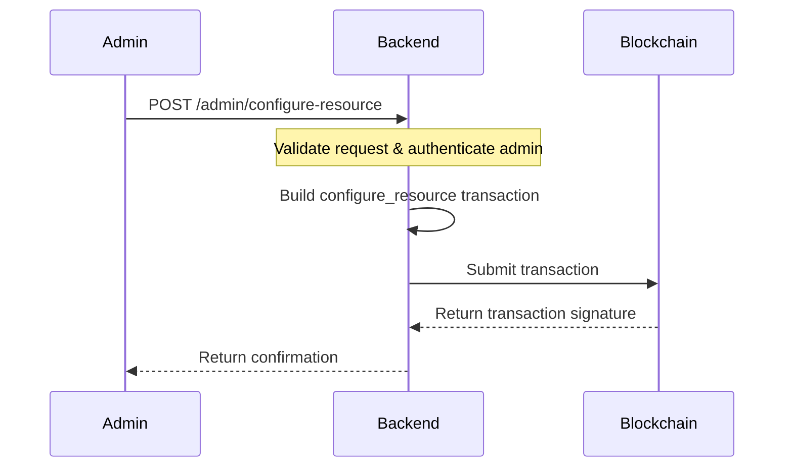
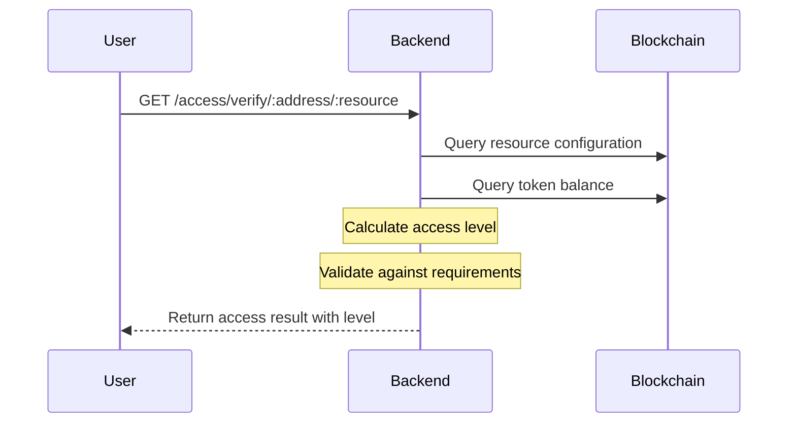
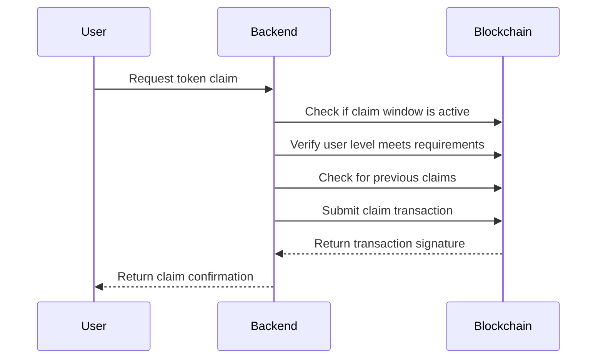

# Token Gating Solana Backend

A robust Rust backend implementation for interacting with the Solana Token Gating program, providing a secure and scalable way to verify and manage token-based access control.

## System Architecture

The backend is structured into four primary layers:

1. **API Layer**: HTTP server that exposes RESTful endpoints
2. **Business Logic Layer**: Core operations that mirror on-chain functions
3. **Integration Layer**: Connects to Solana blockchain via Anchor client
4. **Configuration & Error Management**: Centralized configuration and error handling


## Features

### 1. Resource Configuration and Management
- **Create and Update Resources**: Configurable token-gated resources with custom requirements
- **Resource Retrieval**: Get detailed information about resource configurations
- **Resource Requirements**: Define custom token balance thresholds for access

### 2. Access Control
- **Token-Based Verification**: Verify user access based on token ownership
- **Multi-Level Permissions**: Support for tiered access levels (up to 3 levels)
- **Balance Checking**: Check token balances against required thresholds

### 3. Claim Window Management
- **Time-Limited Access**: Configure time windows for token claims
- **Level Requirements**: Set minimum token levels for claims
- **Claim Prevention**: Stop multiple claims within the same window

### 4. Admin Operations
- **Admin Authentication**: Secure endpoints for administrative actions
- **Multi-Admin Support**: Up to 3 administrator accounts
- **Admin Management**: Add/remove administrators securely

## Quick Start Guide

### Prerequisites
- Rust and Cargo (1.70+)
- Solana CLI tools
- Anchor Framework
- A Solana wallet with SOL for transactions

### Installation

```bash
# Clone the repository
git clone https://github.com/yourusername/token-gating-backend.git
cd token-gating-backend

# Build the project
cargo build --release

# Run the server
RUST_LOG=info ./target/release/token-gating-backend -p 8090
```

### Basic Configuration

Create a `.env` file in the project root:

```
# Solana Blockchain Configuration
SOLANA_CLUSTER=devnet
SOLANA_RPC_URL=https://api.devnet.solana.com
PROGRAM_ID=EHyipzMTK3FV63inZTyvqmSYqFxDdKJPKMhHay6yQ9mw

# Admin Wallet Configuration
ADMIN_KEYPAIR_PATH=/path/to/admin/keypair.json
```

## API Endpoints

| Endpoint | Method | Description |
|----------|--------|-------------|
| `/admin/configure-resource` | POST | Create or update a token-gated resource |
| `/admin/configure-claim` | POST | Create a time-limited claim window |
| `/admin/add` | POST | Add a new administrator for a resource |
| `/admin/remove` | POST | Remove an administrator from a resource |
| `/access/verify/:address/:resource` | GET | Check if a wallet has access to a resource |
| `/resource/requirements/:resource` | GET | Get access requirements for a resource |
| `/transaction/submit` | POST | Submit a pre-built transaction to the blockchain |
| `/health` | GET | Check server health status |

### API Request/Response Examples

#### 1. Configure Resource (Admin)

**Request:**
```bash
curl -X POST "http://localhost:8090/admin/configure-resource" \
  -H "Content-Type: application/json" \
  -d '{
    "name": "premium-content",
    "required_mint": "TokenkegQfeZyiNwAJbNbGKPFXCWuBvf9Ss623VQ5DA",
    "level_thresholds": [10, 50, 100]
  }'
```

**Response:**
```json
{
  "status": "success",
  "resource_signature": "4jTa1mqYFDqhiZxVaYAzjxpQmqEC6rXbQDZ9x4mDkQXG5Jc6RW6Vq5HL1SQQoFsVY3dYvFCCRjytKz3y9zXY39U9",
  "levels_signature": "3hVL7NKkfMn6iZ9Np41TFLCWmNZk1y2ZkU3dYvFCCRjytKz3y9zXY39U94jTa1mqYFDqhiZxVaYAzjxpQmqEC6rX"
}
```

#### 2. Verify Access

**Request:**
```bash
curl -X GET "http://localhost:8090/access/verify/5YNmS1R9nNSCDzb5a7mMJ1dwK9uHeAAF4CerVnwgX5r/premium-content"
```

**Response:**
```json
{
  "address": "5YNmS1R9nNSCDzb5a7mMJ1dwK9uHeAAF4CerVnwgX5r",
  "resource": "premium-content",
  "resource_address": "8zGxf1nS4oqXVwQYCu834tZ2s4j1cuqxZmUDXdJope5e",
  "access_granted": true,
  "has_sufficient_balance": true,
  "current_level": 2,
  "token_balance": 75,
  "required_level": 1,
  "level_thresholds": [10, 50, 100]
}
```

#### 3. Configure Claim Window

**Request:**
```bash
curl -X POST "http://localhost:8090/admin/configure-claim" \
  -H "Content-Type: application/json" \
  -d '{
    "resource_name": "premium-content",
    "start_time": 1683000000,
    "end_time": 1683100000,
    "required_level": 1
  }'
```

**Response:**
```json
{
  "status": "success",
  "signature": "2BG1JJUceebin9LVcwx4H3vMCXHXm5kkLXr8ehtBRmVTvmb53S4VHfniTRUHyWX2aD1K3PhPucKw14nnzjnnSqnN"
}
```

#### 4. Get Resource Requirements

**Request:**
```bash
curl -X GET "http://localhost:8090/resource/requirements/premium-content"
```

**Response:**
```json
{
  "resource": "premium-content",
  "resource_address": "8zGxf1nS4oqXVwQYCu834tZ2s4j1cuqxZmUDXdJope5e",
  "required_mint": "TokenkegQfeZyiNwAJbNbGKPFXCWuBvf9Ss623VQ5DA",
  "level_thresholds": [10, 50, 100],
  "is_active": true
}
```

## Detailed Workflow

### Resource Configuration Flow



### Access Verification Flow



### Claim Window Flow



## Implementation Details

### Token Balance Verification

The backend uses the Solana RPC client to retrieve token account balances:

```rust
pub fn get_token_balance(&self, wallet: &Pubkey, mint: &Pubkey) -> Result<u64, TokenGatingError> {
    // Retrieve token account balance
    let token_account = spl_associated_token_account::get_associated_token_address(wallet, mint);
    
    let balance = self.rpc_client.get_token_account_balance(&token_account)
        .map_err(|e| TokenGatingError::SolanaRpcError(e.to_string()))?;

    Ok(balance.amount.parse().unwrap_or(0))
}
```

### Access Level Calculation

The backend calculates access levels based on token thresholds:

```rust
fn calculate_access_level(&self, balance: u64, thresholds: &[u64]) -> u8 {
    for (index, &threshold) in thresholds.iter().enumerate() {
        if balance >= threshold {
            return (index + 1) as u8;
        }
    }
    0 // No access
}
```

### Claim Window Validation

The backend validates claim windows using timestamp checks:

```rust
fn validate_claim_window(&self, config: &ResourceConfig) -> Result<(), TokenGatingError> {
    let current_timestamp = chrono::Utc::now().timestamp() as u64;

    match (config.claim_window_start, config.claim_window_end) {
        (Some(start), Some(end)) => {
            if current_timestamp < start || current_timestamp > end {
                return Err(TokenGatingError::ClaimWindowClosed);
            }
        },
        _ => {} // No claim window restrictions
    }

    Ok(())
}
```

## Advanced Configuration

### Command Line Arguments

The backend supports several command-line flags:

```bash
# Run with a custom port
./target/release/token-gating-backend -p 9000

# Show available options
./target/release/token-gating-backend --help
```

### Environment Variables

| Variable | Description | Default |
|----------|-------------|---------|
| `SOLANA_CLUSTER` | Solana cluster to connect to | devnet |
| `SOLANA_RPC_URL` | Custom RPC URL | https://api.devnet.solana.com |
| `PROGRAM_ID` | Solana program ID for token gating | EHyipzMTK3FV63inZTyvqmSYqFxDdKJPKMhHay6yQ9mw |
| `ADMIN_KEYPAIR_PATH` | Path to admin keypair file | ~/.config/solana/id.json |
| `RUST_LOG` | Logging level | info |

## Testing and Development

### Running Tests

```bash
# Run all tests
cargo test

# Run a specific test
cargo test test_verify_access

# Run with verbose output
cargo test -- --nocapture
```

### Development Workflow

1. Start the server with development settings:
   ```bash
   RUST_LOG=debug cargo run
   ```

2. Use a test script to verify functionality:
   ```bash
   ./scripts/test_api_flow.sh
   ```

3. Monitor logs for detailed information:
   ```bash
   tail -f backend.log
   ```

## Troubleshooting

### Common Issues

#### "Failed to connect to Solana RPC"
- Check your internet connection
- Verify the RPC URL is correct
- Ensure the Solana cluster is operational

#### "Admin keypair file not found"
- Check the path to your keypair file
- Set `ADMIN_KEYPAIR_PATH` environment variable
- Ensure file permissions allow reading

#### "Insufficient funds for transaction"
- Ensure your admin wallet has SOL for transaction fees
- Use a Solana faucet to get testnet/devnet SOL

#### "Transaction simulation failed"
- Check program logs using `solana logs` command
- Verify input parameters match on-chain program requirements
- Check that resource names are valid (32 characters max)

### Logs and Debugging

The backend uses structured logging with different log levels:

```bash
# Error logs only
RUST_LOG=error ./target/release/token-gating-backend

# Warning and error logs
RUST_LOG=warn ./target/release/token-gating-backend

# Info, warning, and error logs (default)
RUST_LOG=info ./target/release/token-gating-backend

# All debug logs (verbose)
RUST_LOG=debug ./target/release/token-gating-backend

# Very verbose logs
RUST_LOG=trace ./target/release/token-gating-backend
```

## Performance Optimization

- **Caching**: Resource configurations are cached to reduce RPC calls
- **Connection Pooling**: Reuse RPC connections for better performance
- **Transaction Batching**: Group related transactions for efficiency
- **Rate Limiting**: Implement rate limiting to prevent API abuse
- **Connection Retries**: Automatic retry for transient RPC failures

## Security Considerations

- **Key Management**: Sensitive keys are managed securely
- **Rate Limiting**: Prevent abuse of API endpoints
- **Input Validation**: All user inputs are validated
- **Error Masking**: Prevents leaking sensitive information
- **TLS/HTTPS**: Use a reverse proxy like Nginx to add HTTPS
- **Public Key Authentication**: Admin operations require valid signatures
- **Resource Name Validation**: Prevent injection attacks in resource names

## Deployment

### Production Deployment

For production deployment, consider the following:

1. Use a process manager like systemd or PM2:
   ```
   [Unit]
   Description=Token Gating Backend
   After=network.target

   [Service]
   User=solana
   WorkingDirectory=/opt/token-gating
   ExecStart=/opt/token-gating/target/release/token-gating-backend
   Restart=on-failure
   Environment="RUST_LOG=info"
   Environment="SOLANA_CLUSTER=mainnet"
   Environment="SOLANA_RPC_URL=https://your-rpc-url.com"
   Environment="ADMIN_KEYPAIR_PATH=/opt/token-gating/keys/admin.json"

   [Install]
   WantedBy=multi-user.target
   ```

2. Set up NGINX as a reverse proxy:
   ```nginx
   server {
       listen 443 ssl;
       server_name token-gating-api.example.com;

       ssl_certificate /etc/ssl/certs/token-gating.crt;
       ssl_certificate_key /etc/ssl/private/token-gating.key;

       location / {
           proxy_pass http://localhost:8090;
           proxy_http_version 1.1;
           proxy_set_header Upgrade $http_upgrade;
           proxy_set_header Connection 'upgrade';
           proxy_set_header Host $host;
           proxy_cache_bypass $http_upgrade;
       }
   }
   ```

3. Implement rate limiting and IP restrictions for admin endpoints.

### Docker Deployment

```dockerfile
FROM rust:1.70 as builder
WORKDIR /app
COPY . .
RUN cargo build --release

FROM debian:bullseye-slim
WORKDIR /app
COPY --from=builder /app/target/release/token-gating-backend .
COPY --from=builder /app/.env.example .env

RUN apt-get update && apt-get install -y ca-certificates && rm -rf /var/lib/apt/lists/*

EXPOSE 8090
CMD ["./token-gating-backend"]
```

## Development Roadmap

- [ ] Enhanced admin dashboard
- [ ] WebSocket support for real-time updates
- [ ] Pagination for resource listings
- [ ] Enhanced monitoring and analytics
- [ ] Integration with identity verification services
- [ ] Improved caching layer for resource configurations
- [ ] Support for multiple token mints per resource
- [ ] Bulk operations for resource management
- [ ] Advanced metrics and reporting
- [ ] OpenAPI/Swagger documentation

## API Client Libraries

Sample code for integrating with the API in various languages:

### JavaScript/TypeScript
```typescript
async function verifyAccess(walletAddress: string, resourceName: string) {
  const response = await fetch(`http://localhost:8090/access/verify/${walletAddress}/${resourceName}`);
  const data = await response.json();
  return data.access_granted;
}
```

### Python
```python
import requests

def verify_access(wallet_address, resource_name):
    response = requests.get(f"http://localhost:8090/access/verify/{wallet_address}/{resource_name}")
    data = response.json()
    return data["access_granted"]
```

### Rust
```rust
use reqwest::Client;
use serde::Deserialize;

#[derive(Deserialize)]
struct AccessResponse {
    access_granted: bool,
}

async fn verify_access(wallet_address: &str, resource_name: &str) -> Result<bool, reqwest::Error> {
    let client = Client::new();
    let response = client.get(&format!("http://localhost:8090/access/verify/{}/{}", wallet_address, resource_name))
        .send()
        .await?
        .json::<AccessResponse>()
        .await?;
    
    Ok(response.access_granted)
}
```

## Contributing

Contributions are welcome! Please feel free to submit a Pull Request.

1. Fork the repository
2. Create your feature branch (`git checkout -b feature/amazing-feature`)
3. Commit your changes (`git commit -m 'Add some amazing feature'`)
4. Push to the branch (`git push origin feature/amazing-feature`)
5. Open a Pull Request

Please make sure your code follows our coding standards and includes appropriate tests.

## License

This project is licensed under the MIT License - see the LICENSE file for details.

## Acknowledgements

- Solana Foundation for the blockchain infrastructure
- Anchor framework for simplifying Solana program development
- The Rust community for excellent libraries and tools 